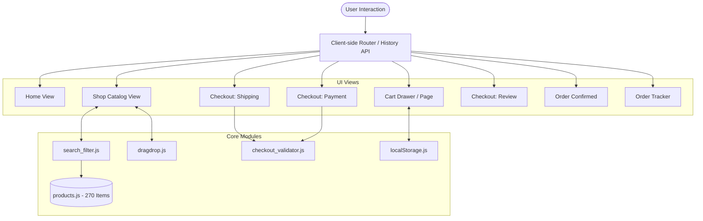
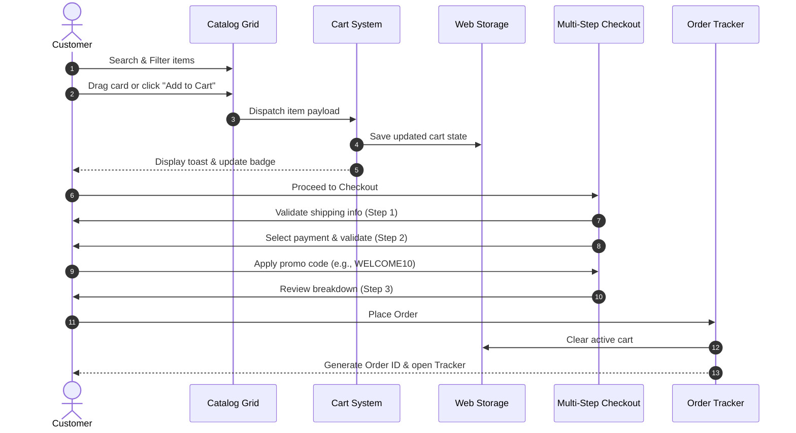

# 🛍️ LeapCart — Premium E-Commerce Catalog & Checkout Platform

<div align="center">


<p align="center">
  <b>A state-of-the-art, responsive e-commerce web application featuring real-time faceted search, native HTML5 drag-and-drop cart addition, multi-step validated checkout, coupon engine, and live order tracking.</b>
</p>

[✨ Live Features](#-key-features) •
[📐 Architecture](#-system-architecture) •
[🧭 User Flow](#-application-workflow) •
[📂 Project Structure](#-directory-structure) •
[🚀 Quick Start](#-getting-started) •
[🎟️ Promo Codes](#-promotional-coupons)

</div>

---

## 🌟 Executive Summary

**LeapCart** is a modern frontend e-commerce platform built without heavy frameworks to prove the power of modern vanilla web standards. Powered by clean HTML5, custom CSS design tokens, Tailwind CSS utility classes, and modular ES6+ JavaScript, LeapCart delivers a native app-like experience with zero compilation overhead.

### ⚡ Key Metrics
* **270+ Curated Products** with high-resolution imagery, detailed descriptions, ratings, and stock status.
* **6 Major Categories & 20+ Subcategories** across Electronics, Apparel, Accessories, Fitness, Home Decor, and Kitchen.
* **8 Dynamic SPA Views** coordinated seamlessly via the browser History API without page reloads.
* **Dual-Input Range Slider** synchronizing dual thumbs and numerical inputs for price filtering up to ₹70,000.
* **Native Drag-and-Drop Shopping** allowing items to be dragged directly into a responsive floating drop zone.
* **3-Step Checkout Flow** with Luhn-algorithm card validation, phone/pincode format checks, and instant review.

---

## 📸 Core Highlights at a Glance

| Feature | Description | Tech Used |
| :--- | :--- | :--- |
| **Faceted Catalog** | Instant multi-condition filtering by keyword, category, subcategory, price, and star rating. | Array higher-order functions & Debounce |
| **Drag & Drop Cart** | Intuitive desktop drag-and-drop interaction with floating drop-zone tray and visual physics. | HTML5 Drag & Drop API |
| **Sliding Cart Drawer & Page** | Accessible slide-over drawer + dedicated cart page with quantity adjustments and LocalStorage sync. | Custom CSS Transitions & Web Storage |
| **Smart Coupon Engine** | Percentage and flat discount codes with live validation and calculation safeguards. | Dynamic discount reducer |
| **3-Step Checkout Flow** | Modular shipping validation, payment verification, and consolidated order confirmation. | Luhn algorithm & regex validators |
| **Real-time Order Tracker** | Interactive timeline with visual tracking nodes from order placement to doorstep delivery. | Dynamic state machine |

---

## 🎯 Key Features

### 1. 🔍 Instant Search & Search History
* **Real-time Querying**: Instant item matching across product names, descriptions, and categories as the user types.
* **Debounced Execution**: Smooth performance without lag or dropped frames during rapid keyboard input.
* **Search History Dropdown**: Automatically remembers and suggests up to 3 recent searches stored in `localStorage`.
* **Cross-Input Synchronization**: Search state persists across top navigation, hero search, and catalog views.

### 2. 🎛️ Deep Faceted Filtering System
* **Dual-Thumb Interactive Price Slider**: Custom dual-slider supporting simultaneous minimum and maximum bounds with synchronized numerical inputs and active track highlighting.
* **Category & Subcategory Pills**: Responsive category sidebar with dynamic subcategory chips that adjust based on selected parent categories.
* **Rating Filters**: One-click star rating filtering (1★ through 5★).
* **Smart Sorting Options**:
  * `Newest`: Latest additions
  * `Price: Low to High` / `Price: High to Low`
  * `Highest Rated`: Top customer satisfaction
  * `Alphabetical`: A to Z sorting
* **Empty State Handling**: Friendly, actionable empty state with a 1-click filter reset button when queries yield no results.

### 3. 🎯 Native Drag-and-Drop Shopping
* **Desktop Drag Support**: Drag any product card to invoke the floating drop-zone tray.
* **Interactive Visual Feedback**: Elevation changes, scale animations, and drop-zone state shifts (`dragover`, `drop`, `success`).
* **Haptic UI Feedback**: Instant badge pulse and cart counter increment upon successful drop.

### 4. 🛒 Dual Cart Experience (Drawer + Full Page)
* **Sliding Cart Drawer**: Fast slide-out overlay for quick item reviews and immediate checkout initiation.
* **Dedicated Cart Page (`#view-cart`)**: Full-screen shopping cart layout for comprehensive item management.
* **Item Controls**: Instant quantity adjustment (`+` / `-`), individual item deletion, and "Clear Cart" reset.
* **LocalStorage Persistence**: Full cart state survives browser refreshes and tab closures.

### 5. 💳 Multi-Step Validated Checkout
A structured 3-phase checkout pipeline ensures accurate order placement:

```
[ Step 1: Shipping Address ] ➔ [ Step 2: Payment Method ] ➔ [ Step 3: Order Review ] ➔ [ Confirmation ]
```

* **Step 1: Shipping Address**:
  * Real-time inline field validation for Full Name, Email, 10-digit Phone, Street, City, and 6-digit Pincode.
  * Informative inline error messages with ARIA live region support.
* **Step 2: Payment Options**:
  * **Cash on Delivery (COD)**: Instant selection with zero transaction friction.
  * **UPI / QR Code**: Handles VPA format validation (`username@bank`) or interactive simulated QR scan.
  * **Credit / Debit Card**:
    * Automatic card issuer detection (Visa, MasterCard, American Express, RuPay).
    * Auto-spaced 16-digit card number formatting.
    * Luhn Algorithm checksum verification.
    * Auto-formatted MM/YY expiration dates and 3/4-digit CVV checks.
* **Step 3: Review & Summary**:
  * Comprehensive itemized breakdown, recipient details, payment method recap, delivery fee calculation, and coupon discount deduction.

### 6. 🎟️ Promotional Coupons & Discounts
Integrated coupon validation module with automated discount computation:

| Code | Type | Value | Condition / Scope |
| :--- | :--- | :--- | :--- |
| `WELCOME10` | Percentage | **10% OFF** | Entire order |
| `SAVE200` | Flat | **₹200 OFF** | Entire order |
| `FASHION15` | Percentage | **15% OFF** | Apparel & Fashion items |
| `ELECTRO10` | Percentage | **10% OFF** | Electronics category |
| `FESTIVE20` | Percentage | **20% OFF** | Festival celebration sale |
| `FIRSTBUY` | Percentage | **20% OFF** | New customer special |
| `HOME250` | Flat | **₹250 OFF** | Home Decor & Kitchen items |

### 7. 🚚 Order Confirmation & Simulated Tracker
* **Celebratory Order View**: Generates a unique order tracking ID (e.g., `LX-98241`), delivery estimate, and order recap.
* **Live Order Tracker (`#view-order-tracker`)**: Five-phase interactive progression:
  1. `Order Placed`
  2. `Processing`
  3. `Shipped`
  4. `Out for Delivery`
  5. `Delivered`

---

## 📐 System Architecture

LeapCart follows a clean **modular Single Page Application (SPA)** architecture without requiring a bundler:



---

## 🧭 Application Workflow



---

## 📂 Directory Structure

```plaintext
Product-Catalog/
│
├── index.html                   # Master SPA layout, views & templates
├── README.md                    # Comprehensive technical documentation
│
├── css/
│   └── styles.css               # Design system tokens, glassmorphism, animations & custom sliders
│
├── js/
│   ├── script.js                # Core app orchestrator, SPA view router & event coordinator
│   │
│   ├── constants/
│   │   ├── coupons.js           # Available coupon codes & discount calculation rules
│   │   └── filterDefaults.js    # Initial baseline filter configuration
│   │
│   ├── context/
│   │   ├── actionTypes.js       # Action constants for app state updates
│   │   ├── AppReducer.js        # Predictable state transition reducer logic
│   │   └── initialState.js      # Global default application state definition
│   │
│   ├── core/
│   │   └── store.js             # Centralized pub/sub state store container
│   │
│   ├── data/
│   │   └── products.js          # Complete catalog database (270 curated items)
│   │
│   ├── modules/
│   │   ├── checkout_module.js   # Checkout event bindings & form handling logic
│   │   ├── dragdrop.js          # HTML5 drag-and-drop listeners & drop-zone tray
│   │   └── search_filter.js     # Search history, debounce, and faceted filter engine
│   │
│   └── utils/
│       ├── calculations.js      # Cart subtotal, tax, and discount math utilities
│       ├── checkout_validator.js# Luhn algorithm, email, phone & pincode validators
│       ├── imageValidator.js    # Image fallback resolver & fallback handler
│       └── localStorage.js      # Safe storage abstraction for cart & search history
│
└── assets/
    ├── products/                # 270+ high-resolution product imagery assets
    ├── images/                  # UI vector graphics and badges
    └── videos/                  # Media assets for hero visual presentation
```

---

## 🛠️ Tech Stack & Design Tokens

### Technologies
* **Structure**: Semantic HTML5 (Custom data views, container queries, accessible forms)
* **Styling**: Tailwind CSS (via CDN) paired with custom CSS3 custom properties
* **Icons & Typography**: Google Fonts (`Inter`), Google Material Symbols Outlined
* **Logic**: Vanilla ECMAScript 2022 (ES Modules, Array Methods, Async/Await)
* **Persistence**: Browser Web Storage API (`localStorage`)

### Color Palette

| Token | Hex Code | Visual Preview | Application |
| :--- | :--- | :--- | :--- |
| `--bg-main-start` | `#080F14` | `⬛ Dark Navy` | Base app background |
| `--bg-card` | `#1F2430` | `⬛ Card Dark` | Product & container cards |
| `--accent-teal` | `#00B8A9` | `🟩 Vibrant Teal` | Primary brand accent & highlights |
| `--accent-coral` | `#FF7A59` | `🟧 Bright Coral` | Badges & active selections |
| `--accent-amber` | `#FFC857` | `🟨 Warm Gold` | Ratings, reviews & sale tags |
| `--text-primary` | `#F7F8FA` | `⬜ Crisp White` | Headlines & primary content |
| `--text-secondary`| `#C8D0DA` | `🔘 Muted Slate` | Descriptions & metadata |

---

## 🚀 Getting Started

Because LeapCart uses standard native ES Modules, no compilation, npm install, or bundler is required.

### Prerequisites
A modern web browser supporting ES6 Modules:
* Chrome / Edge 80+
* Firefox 75+
* Safari 13.1+

### Running Locally

To serve the project with proper MIME type support for ES modules, use any local HTTP server:

#### Option 1: VS Code Live Server (Recommended)
1. Open the project folder in **Visual Studio Code**.
2. Install the **Live Server** extension.
3. Right-click `index.html` and choose **"Open with Live Server"**.

#### Option 2: Python HTTP Server
```bash
# In the project directory:
python3 -m http.server 8000
```
Then visit: `http://localhost:8000`

#### Option 3: Node.js `npx serve`
```bash
npx serve .
```

---

## 📋 Form Validation Rules

LeapCart enforces strict frontend validation prior to checkout submission:

| Field | Validation Requirement | Error Feedback |
| :--- | :--- | :--- |
| **Full Name** | Minimum 3 non-whitespace characters | *"Name must be at least 3 characters"* |
| **Email Address** | Valid RFC-compliant format (`name@domain.com`) | *"Enter a valid email address"* |
| **Phone Number** | Exactly 10 numeric digits | *"Phone must be 10 digits, numbers only"* |
| **Street Address**| Non-empty string | *"Street address is required"* |
| **City** | Non-empty string | *"City is required"* |
| **Pincode** | Exactly 6 numeric digits | *"Pincode must be 6 digits, numbers only"* |
| **Card Number** | 13–19 digits validated with Luhn Algorithm | *"Invalid card number (checksum failed)"* |
| **Expiry Date** | Valid future month/year (`MM/YY`) | *"Card has expired or invalid date"* |
| **CVV Code** | 3 or 4 numeric digits | *"Invalid CVV (3 or 4 digits required)"* |

---

## 💡 Developer Extensibility

* **Adding New Products**: Extend the `products` array in `js/data/products.js` following the object schema:
  ```javascript
  {
    id: 271,
    title: "New Product Title",
    name: "New Product Title",
    category: "Electronics",
    subcategory: "Audio",
    brand: "BrandName",
    description: "Detailed product specifications and highlights...",
    image: "assets/products/your-image.jpg",
    price: 4999,
    rating: 4.8,
    stockStatus: "In Stock"
  }
  ```
* **Adding New Coupons**: Add new discount configurations to `js/constants/coupons.js`.
* **State Management**: LeapCart includes a Pub/Sub Store in `js/core/store.js` and Reducer in `js/context/AppReducer.js` for developers wishing to migrate to unidirectional state dispatch.

---

## 📄 License & Attribution

Developed with ❤️ as a modern, clean, and educational frontend engineering showcase.  
All brand names, trademarks, and sample product photos belong to their respective copyright holders and are used for mock demonstrational purposes only.
